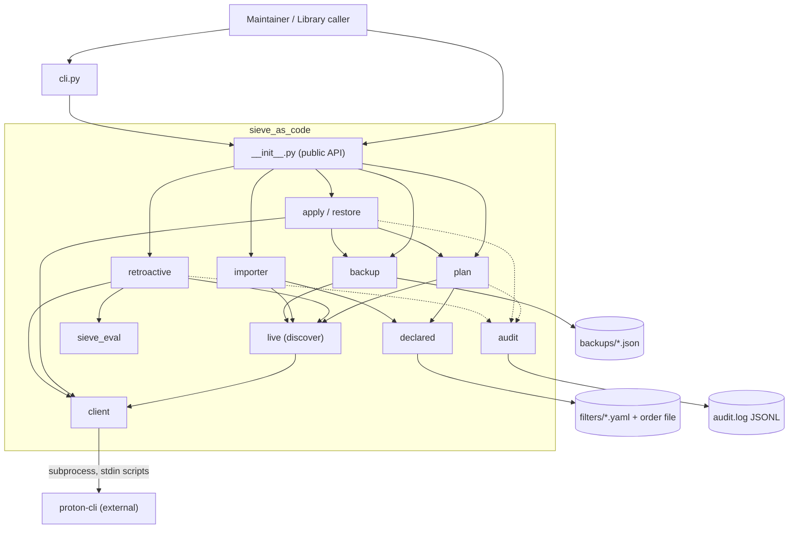
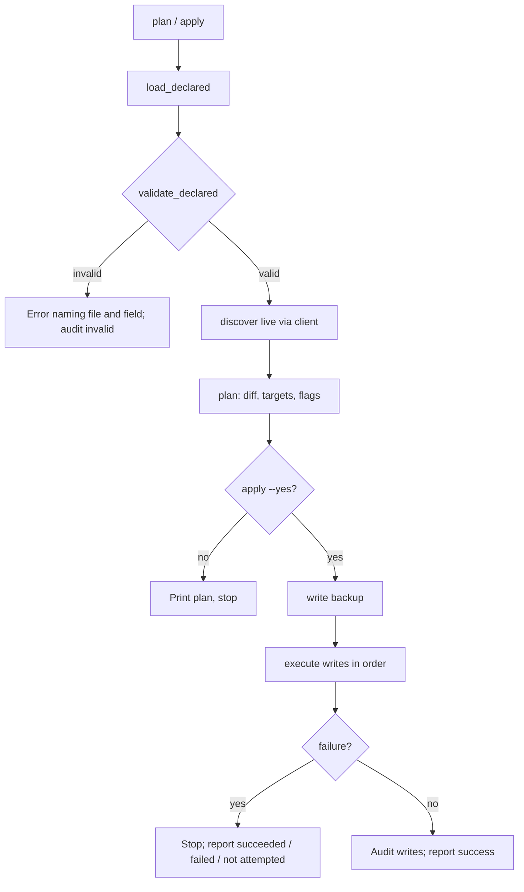
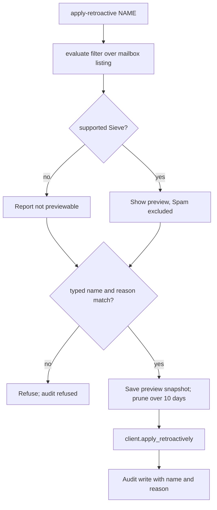

# High-Level Design

## Architecture Overview

One in-process Python package. The only external boundary is the `proton-cli` subprocess, reached through `client.py`. Local files (filters, order, backups, audit log) are the only state.

## Technology Decisions

| Decision | Choice | Rationale | Alternatives Considered |
|---|---|---|---|
| Language | Python ≥3.12 | RVQ-Q12 | — |
| Process boundary | One `client.py` | Single place to fake in tests and to absorb `proton-cli` output changes | Calls spread across modules |
| State | Local files are truth, live read each run | FR-PLAN.4; no baseline file to drift | Stored baseline |
| Results | Frozen dataclasses (`PlanResult`, `ApplyReport`, `RestoreReport`, `RetroPreview`) | Library callers need typed results (FR-CLI.2) | Dicts, printed text |
| Confirmation | Library takes `confirmed: bool`; CLI owns prompts and `--yes` | Library stays non-interactive | Prompts inside library |
| CLI parsing | `argparse` | stdlib first | click, typer |
| Config | Four env vars; account subdirectories by convention | RVQ-Q11, RVQ-Q18; fewer than 10 values | Config file listing accounts |

## Data Flows

### Plan and apply

### Retroactive run

## Cross-Cutting Concerns

| Concern | Strategy | Requirement |
|---|---|---|
| Errors | One base `SieveAsCodeError`; subclasses only where callers branch: validation, client, backup integrity, unsupported Sieve. CLI maps to exit codes: 0 ok, 1 failure or remaining diff, 2 usage or validation | NFR-OPS.1, FR-CLI.1 |
| Validation | Fail fast on the first error, naming file and field | FR-DECL.5 |
| Configuration | Env vars read once in `settings.py`; every path is built from the validated account name | FR-CLI.3, FR-ACCT.5 |
| Logging | Audit JSONL for writes and checks; names and counts only | NFR-SAFE.2 |
| Secrets | None held; the session lives in `proton-cli` | RVQ-Q11 |
| Idempotency / drift | Second `apply` is a no-op; `plan` is the drift check | NFR-REL.1, FR-PLAN.4 |
| Recovery | Pre-write backup (also before restore), verified restore, disable-not-delete | FR-BAK.*, FR-APPLY.5 |
| Wrong account | Fingerprint of the Proton account `id` checked against a marker before any Proton command; snapshots carry it | FR-ACCT.4 |
